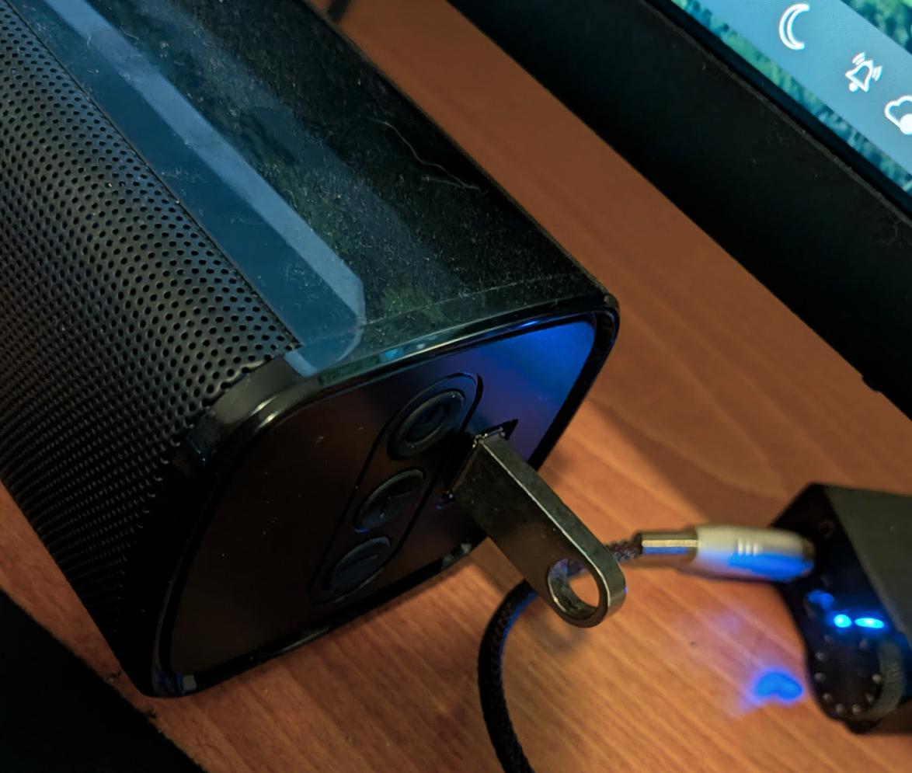
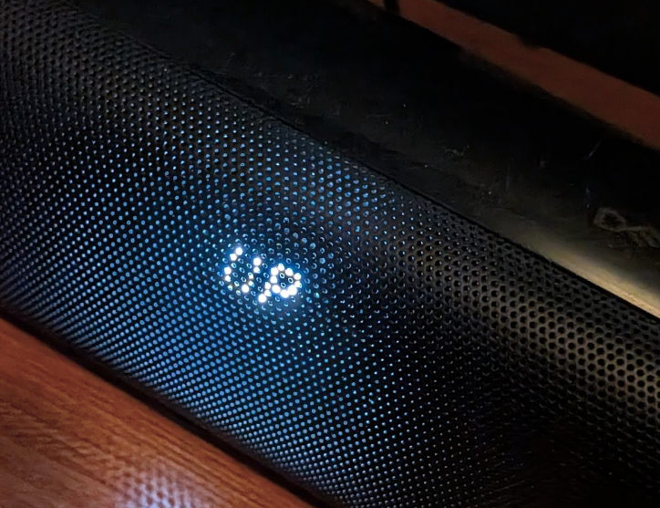
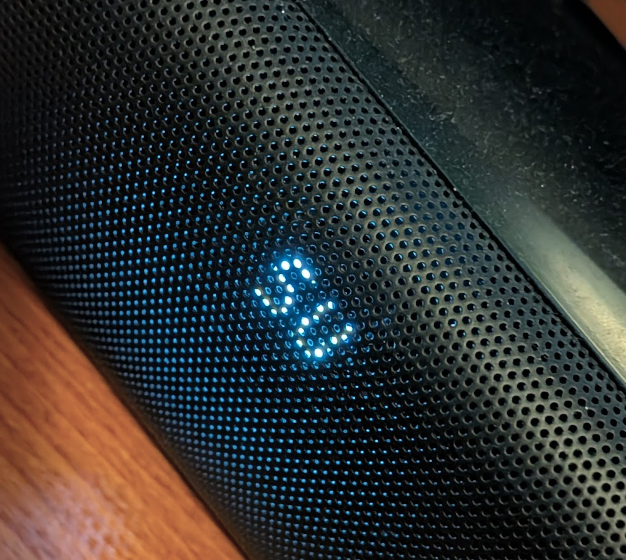

Edit: The firmware from Creative support page didnt actually fix the whole problem. See update below.
Edit #2 2026-11-02: Got an email from reader. See the reverse engineered firmware [section](#reverse-engineered-firmware).

For a long time I have thought that the initial audio delay when playing video or audio had something do with my OS - Aurora Linux. Turns out it was problem with Cretive Stage v1 soundbar I have. This happens when there has been no audio playing for a while, notably when there is no silent "hiss" coming from the speaker.

Stumbled upon few Reddit posts and video about this [^1][^2]
Creative [^3] has made an official firmware fix for this already back in 2019.

SHA256 checksum of the zip is `8b1e091937f752629a6e354abba452e717e186581a0c31a3152da0332e2d9113`
And filename `MF8360 Creative Stage FW upgrader V01.zip`

Patch logs just states the ominious

> General improvements and bugs fixes

The guide is as follows. For it you need a "A thumbdrive with capacity below 32Gb (FAT 16/32)"

>     Download the file onto your local hard disk.
>     Copy the file into an empty thumbdrive.
>     Unzip downloaded file on your thumbdrive.
>     Ensure the speaker is Powered On.
>     Insert the thumbdrive into the speaker's USB A female port.
>     Display will show ‘UP’ indicating updating in progress
>     The update will be considered successful when the display changes to ‘SU’
>     Plug out socket from the mains and remove the thumbdrive
>     Plug in the speaker to the mains and power up the soundbar again.
>     Update complete.

So first prepare a USB drive and format it FAT32. And the copy the contents of aforementioned zip to it. Folder structure should look like this.

```plain
mikael at meso in media/mikael/565C-50B8
✗  tree
.
└── system
    ├── upgrade_Dragon_SDK.bin
    └── upgrade.txt

2 directories, 2 files
```

Then plug in the USB drive to the USB-A port on the side.



Wait for the UP text, and the update process will start.This took less than a minute for me.



Then it shows SU meaning  the update is complete.



Now disconnect the power and after that remove USB drive. Power back up, and everything should work. No more annoying audio delay!

## Alternative firmware fix

The firmware provided by Creative supports page didn't fix the problem, but alleviated it a little bit. It seemed to keep the speaker alive longer, but the audio delay problem would start again after some time.

I uploaded the firmware [here](Stage%20Firmware%20from%20youtube.zip) (SHA256: `d7f683718deb70b698a532692040bf6c322301adb0729fe565efdc60a393017c`

I tried to flash the firmware mentioned in the Youtube video[^4] description, and this seems to actually work.
But now I have discovered that my Creative Stage speaker has a very slight hiss sound constantly on. Will update this post for potential fix - if there is.

## Reverse engineered firmware

A dear reader sent me an email, about having the same problems with the soundbar and then used Claude to reverse engineer the firmware a little bit. End result was a Python script to modify three values

- Silence threshold -> What point is considered background noise (In youtube version this was set very low, so there was constant hiss). Values 0-95
- Attack (wake-up delay) -> How quickly (in ms) the channel opens up after noise has been detected
- Hold (time before mute) -> In seconds how long channel is being kept open

So to simplify: The channel is being closed off when there no noise coming that is above the silence threshold. And when the channel is open there is slight hiss.

The original issue with the "lag" came from the fact that the wake-up delay was 130ms. In Youtube built this was solved with lowering silence threshold, so the channel was being kept constantly open, and it never was muted thus the constant hiss.

In the fix as suggested by the dear reader. The silence threshold was kept normal, but wake-up delay was minimized to 3.4ms, so the channel wakes up faster. The hold time was also raised to 70 seconds.

```plain
louder ↑  music / dialogue 
         quiet scenes  
   40 ── threshold (stock)
         input noise floor ~here      
   10 ── YouTube build threshold ← below the noise floor = never closes
    0                                 input noise floor = 0
```

Tried it myself and it works okay. Also just for curiosity tried to use direct optical connection with the speaker and hiss is still there. So it is originating from the speakers own amplifier and output.

```bash
mikael@meso:~/Documents/dev/creative-stage-fw$ python3 creatives-stage-fw-script.py    
OK. threshold=40 attack=1 hold=20580 frames (~70s)  
Changed 20 bytes: ['0xbc918', '0xbc919', '0xbda9d', '0xbda9e', '0xbdb0c', '0xbdb0d', '0xbdb0e', '0xbee42', '0xbee43', '0xbeeb4', '0xbee  
b5', '0xbeeb6', '0xff010', '0xff011', '0xff012', '0xff013', '0xff014', '0xff015', '0xff016', '0xff017']  
Wrote out/system/  -> copy the whole 'system' folder to a FAT32 USB (<32GB).
```

Also to summarize all the difference between these three firmware versions in the post.

|  | Official Creative V01 | YouTube "no-lag" | Custom (patched official) |
| --- | --- | --- | --- |
| **Source** | Creative support site | YouTube video description | Official V01 + rebuild script |
| **Build** | V4.2.4, Nov 16 2018 | V4.2.4, Nov 16 2018 (separate compile) | V4.2.4, Nov 16 2018 |
| **Silence threshold** | 40 (≈ −55 dBFS) | 10 (≈ −68 dBFS) | 40 (≈ −55 dBFS) |
| **Attack (wake-up delay)** | 38 frames ≈ 130 ms | 9 frames ≈ 34 ms | 1 frame ≈ 7 ms |
| **Hold (time before mute)** | 1038 frames ≈ 3.5 s | 2776 frames ≈ 9.4 s | 20580 frames ≈ 70 s |
| **Clipped first syllable / lag** | Yes | Mostly gone | Gone |
| **Hiss** | Up to 3.5 s after audio stops | Constant | Up to 70 s after audio stops |
| **Quiet scenes muted** | Yes, after 3.5 s | After 9.4 s | Only after 70 s |
| **Bytes changed vs. official** | — | \~55 % (recompiled) | 20 (12 settings + 8 checksum) |
| **Bootloader** | Original | Identical to official | Identical to official |
| **SHA-256 of `upgrade_Dragon_SDK.bin`** | `e18d9b58d4f3ce8dbc590386a91b41fecfc33a8c038e6e0b24ee28971c81ad5c` | `d7f683718deb70b698a532692040bf6c322301adb0729fe565efdc60a393017c` | `53ba88ae2047a7d602bea8cc5d4355280620e4bd2ae3cfad561750fd6bd57f76` |

The script 

Change the .bin name and run with `python script.py`. It exports .bin firmware file which you can flash with the same instructions above.

```python

#!/usr/bin/env python3
# Rebuild a Creative Stage v1 (MF8360) firmware with custom silence-gate parameters.
# Input : official "MF8360 Creative Stage FW upgrader V01" upgrade_Dragon_SDK.bin
# Output: ./out/system/{upgrade_Dragon_SDK.bin, upgrade.txt}
import os

# ============================== KNOBS ==============================
THRESHOLD    = 40     # silence level. Keep ~40. Lower -> risk hiss; higher -> cuts quiet audio. (<=95)
ATTACK       = 1      # signal frames before un-mute. 1..3. Lower = faster wake.
HOLD_SECONDS = 70     # silence seconds before mute. ~294 frames/s; max ~223 s (16-bit counter).
INPUT        = "og_crefw_upgrade_Dragon_SDK.bin"   # path to the OFFICIAL image
# ==================================================================

BASE      = 0x58000000
LIT_ADDR  = 0x580bc918   # free 4-aligned padding slot (between two functions) for a >2047 hold value
FRAMES_PER_SEC = 294

def enc_movin(reg, imm):                 # movi.n aReg, imm (0..95) -> 2 bytes
    assert 0 <= imm <= 95, "movi.n immediate out of range"
    return bytes([((imm >> 4) & 0x7) << 4 | 0x0c, ((imm & 0x0f) << 4) | reg])

def enc_movi(reg, imm):                  # movi aReg, imm12 (-2048..2047) -> 3 bytes
    assert -2048 <= imm <= 2047, "movi immediate out of range"
    i = imm & 0x0fff
    return bytes([(reg << 4) | 0x02, (0xa << 4) | ((i >> 8) & 0x0f), i & 0xff])

def enc_l32r(reg, pc, target):           # l32r aReg, target (target below pc, 4-aligned) -> 3 bytes
    off = target - ((pc + 3) & ~3)
    assert off < 0 and off % 4 == 0 and off >= -0x40000, "l32r target out of range"
    imm16 = (off >> 2) & 0xffff
    return bytes([(reg << 4) | 0x01, imm16 & 0xff, (imm16 >> 8) & 0xff])

def build(stock, thr, attack, hold):
    assert 0 <= thr <= 95, "THRESHOLD must be 0..95"
    assert 1 <= attack <= 95, "ATTACK must be small (1..3 recommended)"
    assert 1 <= hold <= 65535, "HOLD frames must be 1..65535"
    d = bytearray(stock)
    def put(off, old, new, name):
        if d[off:off+len(old)] != old:
            raise SystemExit(f"Base mismatch @0x{off:x} ({name}). "
                             f"This is not the official V01 image (or already patched).")
        d[off:off+len(new)] = new
    # THRESHOLD — 4 sites: main-path L/R and adpcm-path L/R
    put(0x0beded, bytes([0x2c,0x8e]),      enc_movin(14, thr), "threshold main L")
    put(0x0bedf8, bytes([0x2c,0x82]),      enc_movin(2,  thr), "threshold main R")
    put(0x0bda56, bytes([0xb2,0xa0,0x28]), enc_movi(11,  thr), "threshold adpcm L")
    put(0x0bda62, bytes([0x2c,0x8d]),      enc_movin(13, thr), "threshold adpcm R")
    # ATTACK — 2 sites
    put(0x0bee42, bytes([0x2c,0x69]),      enc_movin(9, attack), "attack main")
    put(0x0bda9d, bytes([0x2c,0x65]),      enc_movin(5, attack), "attack adpcm")
    # HOLD — 2 sites (movi if it fits, else l32r + shared literal)
    for off, reg, pc in [(0x0beeb4, 11, 0x580beeb4), (0x0bdb0c, 7, 0x580bdb0c)]:
        old = bytes([(reg << 4) | 0x02, 0xa4, 0x0e])          # original: movi aReg, 0x40e (1038)
        put(off, old, enc_movi(reg, hold) if hold <= 2047 else enc_l32r(reg, pc, LIT_ADDR), "hold")
    if hold > 2047:
        lo = LIT_ADDR - BASE
        if d[lo:lo+4] != b"\x00\x00\x00\x00":
            raise SystemExit("Literal slot not free — unexpected base image.")
        d[lo:lo+4] = hold.to_bytes(4, "little")
    # Recompute the two affected checksums (32-bit little-endian word sums)
    def wsum(s, e):
        x = 0
        for p in range(s, e, 4):
            x = (x + int.from_bytes(d[p:p+4], "little")) & 0xffffffff
        return x
    d[0xff014:0xff018] = wsum(0x30000, 0xff010).to_bytes(4, "little")  # "app" region
    d[0xff010:0xff014] = wsum(0x00000, 0xff010).to_bytes(4, "little")  # "all" region
    return bytes(d)

def main():
    stock = open(INPUT, "rb").read()
    if len(stock) != 1044512:
        raise SystemExit(f"Unexpected size {len(stock)} (expected 1044512). Wrong file?")
    hold = max(1, min(65535, round(HOLD_SECONDS * FRAMES_PER_SEC)))
    out = build(stock, THRESHOLD, ATTACK, hold)
    os.makedirs("out/system", exist_ok=True)
    open("out/system/upgrade_Dragon_SDK.bin", "wb").write(out)
    open("out/system/upgrade.txt", "w").write("upgrade_Dragon_SDK.bin")
    changed = [hex(i) for i in range(len(out)) if out[i] != stock[i]]
    print(f"OK. threshold={THRESHOLD} attack={ATTACK} hold={hold} frames (~{hold/FRAMES_PER_SEC:.0f}s)")
    print(f"Changed {len(changed)} bytes: {changed}")
    print("Wrote out/system/  -> copy the whole 'system' folder to a FAT32 USB (<32GB).")

if __name__ == "__main__":
    main()
```

Here are the original Claude produced documents about the fix process.

FIRMWARE_INTERNALS.md

````plain
# Creative Stage v1 (MF8360) — firmware internals & reverse-engineering reference

*For an AI agent (or engineer) who wants to go deeper than the three tunable parameters.
Everything below was recovered by static analysis of the official `upgrade_Dragon_SDK.bin`.
Addresses are CPU addresses; file offset = CPU address − `0x58000000` unless noted.*

Companion files:
- `upgrade_Dragon_SDK.bin` — a prebuilt image with sane parameters.
- `REBUILD_INSTRUCTIONS.md` — dependency-free Python to rebuild with custom parameters.
- **this file** — the map for going further (new features, deeper patches, other models).

---

## 1. Hardware & platform

| Thing | Value | Evidence |
|---|---|---|
| Product | Creative Stage (MF8360), v1, 2018 | model/label |
| SoC vendor | **Optek** (fabless BT-audio) | string `OPTEK GATT` (their BLE GATT stack) |
| CPU/DSP core | **Cadence Tensilica HiFi2** (Xtensa ISA) | strings `Tensilica HiFi2 mSBC Decoder`, `*** _xt_panic() ...`; ESP32-like Xtensa memory map |
| RTOS | **Express Logic ThreadX** (Xtensa port) | `Copyright ... ThreadX Xtensa Version G5.1.5.1 SN: optek-eval` |
| "Dragon SDK" | Optek's platform/SDK codename | firmware filename `upgrade_Dragon_SDK.bin` |
| Power amp | **AD83586B** (I²C class-D w/ digital volume + soft-mute) | strings `AD83586B_Set_Mute_on/off`, `AD83586B_Write` |
| DSP libs | Optek BQRIIR / DRC&VOL / EBASS / VOL | version strings around file `0x66cff` |
| Build stamp | **V4.2.4**, `Nov 16 2018 20:28:32` | strings at `0x32f70` |

## 2. Image format

- `upgrade_Dragon_SDK.bin`, **1,044,512 bytes** (`0xFF020`).
- **No encryption, no compression** (byte entropy ~6–7 throughout). Plain flash dump.
- **XIP:** code executes from flash; CPU addr = `0x58000000` + file offset.
  Fast code/data is copied into RAM: IRAM at `0x400xxxxx`, DRAM at `0x3fefxxxx`–`0x3ffxxxxx`.
- **Scatter-load table** at file `0xcc0`: triplets `{load_start@0x40.., load_end@0x40.., src@0x58..}`
  used by the loader to copy sections flash→RAM at boot.

### Sub-image layout

| Region | File range | Contents |
|---|---|---|
| `upgrade_base_bin` | `0x00000`–`0x20000` | Xtensa reset stub + **bootloader / USB-FAT32 upgrader** (code from `0x1000`; RAM-resident) |
| `standby_eco_bin` | `0x20000`–`0x30000` | low-power **standby/ECO** image (~36 KB; code from `0x21000`) |
| `app_bin` | `0x30000`–~`0xda8d3` | **main application** + audio decoders (code from `0x31000`) |
| config | `0xfb000`–`0xfb216` | `"Creative Stage"` + settings |
| checksum trailer | `0xff000`–`0xff020` | `"USBAPP"` tag + 4 checksums |

Each sub-image begins with the same Xtensa entry stub `06 0f 00 00 20 05 ff 58 …`
(a jump + a literal pool full of `0x3fef_xxxx`/`0x4000_xxxx` addresses).

## 3. Integrity — checksums (no crypto)

At `0xff000`: ASCII tag `USBAPP`. At `0xff010`, four **uint32 little-endian word-sums**
(sum of 32-bit LE words mod 2³²):

| Offset | Name | Covers |
|---|---|---|
| `0xff010` | all | Σ u32 `[0x00000, 0xff010)` |
| `0xff014` | app | Σ u32 `[0x30000, 0xff010)` |
| `0xff018` | standby_eco | Σ u32 `[0x20000, 0x30000)` |
| `0xff01c` | upgrade_base | Σ u32 `[0x00000, 0x20000)` |

To patch the app: recompute `app` (`0xff014`) and `all` (`0xff010`); the other two are
unchanged if you don't touch those regions. There is **no signature or MAC** — the only
gate is these sums plus the upgrader's own sanity checks (`... checksum error`).

## 4. Bootloader / upgrader

Lives in `upgrade_base_bin` (file `0x1000`+). USB host + FatFS. Looks for a `system/`
folder on a FAT32 stick (<32 GB) containing `upgrade.txt` (one line: the bin name) and the
bin. Shows `UP` while writing, `SU` on success. Relevant strings around file `0x1000`–`0x1b00`
(`Program Flash`, `Erase Flash`, `cann't find system folder`, `read upgrade.txt`, …).
It is loaded to RAM before running, so its `l32r` references point at `0x40xxxxxx`, not the
flash copy — keep that in mind when tracing it.

## 5. Audio silence-gate subsystem (the part that causes lag/hiss)

This is where the lag/hiss behaviour lives. It is **per-audio-frame** logic, entirely
separate from deep standby (§7).

### 5.1 Level meter
16-bit L/R peak levels are written to **`0x3ff079e0` (L)** and **`0x3ff079e2` (R)** by the
meter routine near **`0x580c7588`** (programs a HW peak register; scale involves `0x4000`/`0x8000`
→ threshold `40` ≈ −55 dBFS, `10` ≈ −68 dBFS).

### 5.2 Detectors (three, sharing the same three constants)
| Fn | Path | Marker strings |
|---|---|---|
| `0x580becac` | main / "KV" | `direct out mute on/off`, `[KV]:status play/pause`, `[Aw] L:%x,R:%x` |
| `0x580bd97c` | ADPCM / S/PDIF | `adpcm detect mute on/off` |
| `0x580bdccc` | non-PCM (Dolby/DTS passthrough) | `detected non-pcm format audio`, `Spdif stream reinit` |

### 5.3 State globals
- **G = `0x3ff02050`**: `G+0` = mute flag, `G+1` = aux flag, **`G+2` = silence (release) counter**,
  **`G+4` = signal (attack) counter**, `G+186` = play/pause state, `G+188` = debug-print throttle.
- **F = `0x3fefca50`**: shared "currently muted" flag (written by all detectors; read by
  `0x580c1770`, `0x580c1804`, `VolMuteSwitch`).
- **P = `0x3ff025f4`**: mode/source bytes (`P+101`, `P+154`, `P+163`, `P+177`, …).

### 5.4 State machine (per frame, ~3.4 ms/frame; ~294 frames/s — measured)
```
level = max(L, R)                       # L=[0x3ff079e0], R=[0x3ff079e2]
if level > THRESHOLD:                    # "signal"
    G.silence_ctr = 0
    if muted:
        G.signal_ctr += 1
        if G.signal_ctr > ATTACK:        # un-mute
            muted = 0; fade DSP volume up; log "direct out mute off"
else:                                     # "silence"
    G.signal_ctr = 0
    G.silence_ctr += 1
    if G.silence_ctr > HOLD:             # mute
        muted = 1; fade DSP volume to 0; log "direct out mute on"
```
The mute is a **DSP volume fade to true zero** (not an input/clock cut), so it is fast and
clean; the perceived lag is `ATTACK` frames + fade, and the perceived hiss is program noise
that leaks through when `THRESHOLD` is set below the noise floor.

### 5.5 DSP fade helpers (the "direct out mute")
`0x580c34cc/34e0/34fc/3510` (+ `0x580c3444`) write ramp durations to the DSP control struct
**`0x3ff028f4`** (fields `+86`, `+88`, `(arg+24)/25` = step count). This ramps the DSP output
volume; muting drives it to digital zero.

### 5.6 The three tunable constants (exact sites)
| Constant | Sites (file offset · original bytes · instr) |
|---|---|
| THRESHOLD (=40) | `0xbeded` `2c 8e` movi.n a14,40 · `0xbedf8` `2c 82` movi.n a2,40 · `0xbda56` `b2 a0 28` movi a11,40 · `0xbda62` `2c 8d` movi.n a13,40 |
| ATTACK (=38) | `0xbee42` `2c 69` movi.n a9,38 · `0xbda9d` `2c 65` movi.n a5,38 |
| HOLD (=1038, `0x40e`) | `0xbeeb4` `b2 a4 0e` movi a11,0x40e · `0xbdb0c` `72 a4 0e` movi a7,0x40e |

`movi` immediate max = 2047; for a larger HOLD, replace `movi` with `l32r aReg,<lit>` (same
3-byte size) and store the value in a free 4-aligned slot (e.g. **`0x580bc918`**, padding
between `retw@0x580bc913` and `entry@0x580bc91c`; reachable by `l32r` from both sites).
The 16-bit counter caps HOLD at 65535 (~223 s).

## 6. Amp control (AD83586B) — clean I²C soft-mute

- **vtable at `0x58032fa8`**: `[+0]` = `AUDIO_AMP_INIT` (`0x580c463c`, ~10 `AD83586B_Write`
  calls), `[+24]` = `AD83586B_Set_Mute` (`0x580c44d4`).
- `AD83586B_Set_Mute(arg)`: soft **volume ramp** loop, then an **I²C register write** via
  `AD83586B_Write` (`0x580c3ca0`). Produces true, click-free silence and is instantly
  reversible.
- Called on the **play/pause status** path (via `VolMuteSwitch`, `0x580b88d0`), **not** from
  the per-frame silence gate. So a "keep DSP live, gate hiss at the amp" design (see §9) would
  require wiring `AD83586B_Set_Mute` into the detector.

## 7. Deep standby / ECO (separate from the per-scene lag)

`ENTER STANDBY` (`0x580b7078`) → teardown `0x580ba47c` ("Standby Nor Enter"): powers down
HDMI (`HDMI_auto_power_on 0/1`, `0x580ccd18`) and gates clocks/peripherals via the
`0x580c83xx`–`0x580c86xx` cluster. This is a **long-idle** event, not the per-quiet-scene
mute — do not confuse the two.

## 8. Relationship between the two public firmwares

The **official** and the **YouTube "no-lag"** images are the *same build* (identical
`__DATE__`/`__TIME__` `V4.2.4 Nov 16 2018 20:28:32`). The YouTube one is a **binary patch**
of just a few constants: THRESHOLD `40→10`, ATTACK `38→9`, HOLD `1038→2776`. The ~68% raw
byte diff between them is almost entirely **relocation noise** (Xtensa position-dependent
literal pools shifting), not logic — a useful lesson when diffing two builds of this SoC.

## 9. Ideas for going deeper

- **Amp-gated silence ("keep DSP live"):** don't fade the DSP at all; instead call
  `AD83586B_Set_Mute` from the detector on long silence and release it instantly. Removes
  onset clipping entirely. Needs a code injection (the detector doesn't call the amp today):
  overwrite one instruction with a jump to a code cave, do the amp call + the displaced
  instruction, jump back (trampoline). Amp vtable/entry points are in §6; free padding slots
  exist between functions (e.g. `0x580bc918`, and larger gaps at `0x71c75`, `0xda8d3`+).
- **Per-source parameters:** the three detectors (§5.2) share constants but are distinct
  functions; you can give S/PDIF-passthrough vs. analog/BT different behaviour.
- **EQ/DRC/bass:** the Optek BQRIIR / DRC&VOL / EBASS coefficient blocks live near file
  `0x66cff`+ and in the DSP struct `0x3ff028f4`; a target for tone/loudness tweaks.

## 10. Tooling & Xtensa notes

- Disassembler: `radare2` / `rasm2` (`rasm2 -a xtensa -D <hex>`). **Caveat:** r2's `baddr`
  IO was unreliable on this raw image — extract bytes and feed `rasm2` from a script, adding
  the base address yourself.
- ABI: Xtensa **windowed** (call8/call4/call12; functions start `entry aSP,N` = opcode `0x36`,
  end `retw.n` = `1d f0` or `retw` = `90 00 00`). Outgoing args for `call8` start at `a10`.
- **`l32r aT, label`** loads a 32-bit constant from a 4-aligned literal *below* the PC:
  `target = ((PC+3) & ~3) + (sign_extend(imm16) << 2)` (imm16 always negative). Follow these
  to resolve string/global/function pointers.
- Instruction encodings used for patching:
  - `movi.n aR, imm` (imm 0..95) → `[ (imm>>4)&7 <<4 | 0x0c , (imm&0xf)<<4 | R ]`
  - `movi aR, imm12` → `[ R<<4 | 0x02 , 0xa<<4 | (imm>>8)&0xf , imm&0xff ]`
  - `l32r aR, tgt` → `off=tgt-((PC+3)&~3); imm16=(off>>2)&0xffff; [ R<<4|0x01, imm16&0xff, imm16>>8 ]`
- Find string cross-refs by locating the 4-byte pointer (`0x58000000+str_off`) in a literal
  pool, then the `l32r` that resolves to that literal.
- After any edit: recompute the checksums in §3 (`app` + `all`), keep total size 1,044,512.

## 11. Quick facts to re-derive on a different image/model

If the offsets don't match (different model or firmware version): the anchors that make
re-mapping fast are the marker strings in §5.2/§6/§7 — find them, find the `l32r` that loads
each (§10), and the enclosing `entry` is the function. The checksum scheme (§3) and XIP base
(`0x58000000`) are the two things to confirm first.
````

REBUILD_INSTRUCTIONS.md

````plain
# Creative Stage v1 (MF8360) — custom firmware rebuild instructions

*For an AI coding agent. This document is self-contained: it explains the mechanism,
the tunable parameters, and includes a dependency-free Python script that rebuilds a
flashable image from the **official** firmware with your chosen parameters.*

---

## TL;DR

The soundbar's audio lag is caused by a **silence gate** in the firmware: when the
input level stays below a threshold it fades the channel to digital zero, and it only
fades back up after it detects returning audio. Three constants control its behaviour.
This build keeps the **hiss-safe** level threshold and only changes **responsiveness**
and **how long it waits before muting**, so you get instant wake, no hiss, and no
cutting of quiet passages.

You do **not** need to disassemble anything. Edit the three knobs at the top of the
script, point it at the official firmware, run it. It patches ~11 bytes and recomputes
the checksums.

---

## What you're editing

- **SoC / DSP:** Optek BT-audio chip, Cadence Tensilica HiFi2 DSP ("Dragon SDK").
- **Image:** `upgrade_Dragon_SDK.bin`, a plain **unencrypted** flash dump, 1,044,512 bytes.
  Flash is execute-in-place; file offset `X` maps to CPU address `0x58000000 + X`.
- **Integrity:** four 32-bit **little-endian word-sum** checksums live at the end of the
  file (`0xff010`..`0xff020`). No CRC, no signature, no crypto. If you change any byte you
  must recompute them or the bootloader rejects the image (`... checksum error`). The
  script does this for you.
- **Base image:** the official *"MF8360 Creative Stage FW upgrader V01"* (2019). The
  script verifies the original bytes at each patch site and aborts if they don't match,
  so it won't silently corrupt a different image.

## The silence gate (what the knobs do)

The detector runs once per audio frame (~3.4 ms). It reads the L/R peak level and:

- if `level > THRESHOLD` on either channel → **signal**: after `ATTACK` consecutive
  signal frames, it un-mutes (fades the channel back up);
- else → **silence**: after `HOLD` consecutive silence frames, it mutes (fades to zero).

Two independent detectors (main path + S/PDIF-ADPCM path) share the same three constants,
and the script patches both.

| Knob | What it controls | Effect | Safe range |
|---|---|---|---|
| `THRESHOLD` | the "is this silence?" level | **hiss vs. cutting quiet content.** ~40 sits just above the noise floor. Lower → the noise floor reads as signal → constant hiss (this is what the YouTube build did at 10). Higher → quiet content gets muted. | keep **40**; explore **35–50** at most |
| `ATTACK` | frames of signal before un-muting | **wake latency / first-syllable clipping.** Lower = faster. 1 ≈ ~7 ms. | **1–3** |
| `HOLD` | frames of silence before muting | **how long a quiet passage survives.** Higher = quiet scenes/pauses aren't cut, but the channel stays live longer on real idle before it powers down. | see calibration below |

**Calibration:** ~**294 frames per second** (measured: 20480 frames ≈ 70 s). So
`HOLD_frames ≈ seconds × 294`. The counter is 16-bit, so the max is 65535 (~223 s).
Set `HOLD_SECONDS` in the script and it converts for you.

**Recommended (the build in this archive):** `THRESHOLD=40`, `ATTACK=1`, `HOLD_SECONDS≈70`.
- Want quiet scenes to survive even longer? Raise `HOLD_SECONDS` (costs: longer before it
  goes quiet on true idle — only audible if your source emits a noise floor when idle).
- Still clipping very soft speech onsets? Try `THRESHOLD=35` (watch for hiss) before
  touching anything else.

---

## The build script

Pure Python 3, no dependencies. Save as `build_fw.py`, put the official
`upgrade_Dragon_SDK.bin` next to it, run `python3 build_fw.py`. Output goes to
`./out/system/` ready to copy to a USB stick.

```python
#!/usr/bin/env python3
# Rebuild a Creative Stage v1 (MF8360) firmware with custom silence-gate parameters.
# Input : official "MF8360 Creative Stage FW upgrader V01" upgrade_Dragon_SDK.bin
# Output: ./out/system/{upgrade_Dragon_SDK.bin, upgrade.txt}
import os

# ============================== KNOBS ==============================
THRESHOLD    = 40     # silence level. Keep ~40. Lower -> risk hiss; higher -> cuts quiet audio. (<=95)
ATTACK       = 1      # signal frames before un-mute. 1..3. Lower = faster wake.
HOLD_SECONDS = 70     # silence seconds before mute. ~294 frames/s; max ~223 s (16-bit counter).
INPUT        = "upgrade_Dragon_SDK.bin"   # path to the OFFICIAL image
# ==================================================================

BASE      = 0x58000000
LIT_ADDR  = 0x580bc918   # free 4-aligned padding slot (between two functions) for a >2047 hold value
FRAMES_PER_SEC = 294

def enc_movin(reg, imm):                 # movi.n aReg, imm (0..95) -> 2 bytes
    assert 0 <= imm <= 95, "movi.n immediate out of range"
    return bytes([((imm >> 4) & 0x7) << 4 | 0x0c, ((imm & 0x0f) << 4) | reg])

def enc_movi(reg, imm):                  # movi aReg, imm12 (-2048..2047) -> 3 bytes
    assert -2048 <= imm <= 2047, "movi immediate out of range"
    i = imm & 0x0fff
    return bytes([(reg << 4) | 0x02, (0xa << 4) | ((i >> 8) & 0x0f), i & 0xff])

def enc_l32r(reg, pc, target):           # l32r aReg, target (target below pc, 4-aligned) -> 3 bytes
    off = target - ((pc + 3) & ~3)
    assert off < 0 and off % 4 == 0 and off >= -0x40000, "l32r target out of range"
    imm16 = (off >> 2) & 0xffff
    return bytes([(reg << 4) | 0x01, imm16 & 0xff, (imm16 >> 8) & 0xff])

def build(stock, thr, attack, hold):
    assert 0 <= thr <= 95, "THRESHOLD must be 0..95"
    assert 1 <= attack <= 95, "ATTACK must be small (1..3 recommended)"
    assert 1 <= hold <= 65535, "HOLD frames must be 1..65535"
    d = bytearray(stock)
    def put(off, old, new, name):
        if d[off:off+len(old)] != old:
            raise SystemExit(f"Base mismatch @0x{off:x} ({name}). "
                             f"This is not the official V01 image (or already patched).")
        d[off:off+len(new)] = new
    # THRESHOLD — 4 sites: main-path L/R and adpcm-path L/R
    put(0x0beded, bytes([0x2c,0x8e]),      enc_movin(14, thr), "threshold main L")
    put(0x0bedf8, bytes([0x2c,0x82]),      enc_movin(2,  thr), "threshold main R")
    put(0x0bda56, bytes([0xb2,0xa0,0x28]), enc_movi(11,  thr), "threshold adpcm L")
    put(0x0bda62, bytes([0x2c,0x8d]),      enc_movin(13, thr), "threshold adpcm R")
    # ATTACK — 2 sites
    put(0x0bee42, bytes([0x2c,0x69]),      enc_movin(9, attack), "attack main")
    put(0x0bda9d, bytes([0x2c,0x65]),      enc_movin(5, attack), "attack adpcm")
    # HOLD — 2 sites (movi if it fits, else l32r + shared literal)
    for off, reg, pc in [(0x0beeb4, 11, 0x580beeb4), (0x0bdb0c, 7, 0x580bdb0c)]:
        old = bytes([(reg << 4) | 0x02, 0xa4, 0x0e])          # original: movi aReg, 0x40e (1038)
        put(off, old, enc_movi(reg, hold) if hold <= 2047 else enc_l32r(reg, pc, LIT_ADDR), "hold")
    if hold > 2047:
        lo = LIT_ADDR - BASE
        if d[lo:lo+4] != b"\x00\x00\x00\x00":
            raise SystemExit("Literal slot not free — unexpected base image.")
        d[lo:lo+4] = hold.to_bytes(4, "little")
    # Recompute the two affected checksums (32-bit little-endian word sums)
    def wsum(s, e):
        x = 0
        for p in range(s, e, 4):
            x = (x + int.from_bytes(d[p:p+4], "little")) & 0xffffffff
        return x
    d[0xff014:0xff018] = wsum(0x30000, 0xff010).to_bytes(4, "little")  # "app" region
    d[0xff010:0xff014] = wsum(0x00000, 0xff010).to_bytes(4, "little")  # "all" region
    return bytes(d)

def main():
    stock = open(INPUT, "rb").read()
    if len(stock) != 1044512:
        raise SystemExit(f"Unexpected size {len(stock)} (expected 1044512). Wrong file?")
    hold = max(1, min(65535, round(HOLD_SECONDS * FRAMES_PER_SEC)))
    out = build(stock, THRESHOLD, ATTACK, hold)
    os.makedirs("out/system", exist_ok=True)
    open("out/system/upgrade_Dragon_SDK.bin", "wb").write(out)
    open("out/system/upgrade.txt", "w").write("upgrade_Dragon_SDK.bin")
    changed = [hex(i) for i in range(len(out)) if out[i] != stock[i]]
    print(f"OK. threshold={THRESHOLD} attack={ATTACK} hold={hold} frames (~{hold/FRAMES_PER_SEC:.0f}s)")
    print(f"Changed {len(changed)} bytes: {changed}")
    print("Wrote out/system/  -> copy the whole 'system' folder to a FAT32 USB (<32GB).")

if __name__ == "__main__":
    main()
```

## Flashing & reverting

1. Copy the produced **`system`** folder (containing `upgrade_Dragon_SDK.bin` and
   `upgrade.txt`) to the root of a **FAT32** USB stick (< 32 GB).
2. Plug it into the soundbar's USB-A port. The display shows **`UP`** while flashing and
   **`SU`** on success.
3. **Revert** any time by flashing the **official** image back the same way.

## Safety notes

- Only ~11 bytes of application code change; the bootloader and the standby sub-image are
  left byte-identical, so it's low risk and fully reversible.
- The script refuses to run unless the base bytes at every patch site match the official
  V01 image — so it can't silently corrupt a different firmware version.
- Always keep the official image so you can roll back. Test on real content (dialogue that
  starts after a pause, and long quiet scenes) after flashing.
````

[^1]: https://www.reddit.com/r/Soundbars/comments/mau0wh/creative_stage_21_dropping_sound_at_specific/)
[^2]: https://www.youtube.com/watch?v=MdNxCXcltHA
[^3]: https://support.creative.com/Products/ProductDetails.aspx?catID=4&subCatID=848&prodID=23279&prodName=Creative%20Stage&subCatName=Creative&CatName=
[^4]: https://www.youtube.com/watch?v=MdNxCXcltHA
